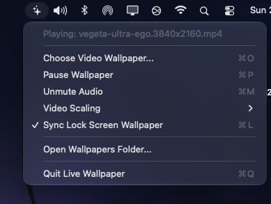

# 🌌 LiveWallpaper for macOS

A lightweight, 100% native macOS Menu Bar live wallpaper application built in Swift with `AVFoundation` and `AppKit`.

* **Ultra-efficient:** Uses macOS hardware video decoding (~0.5%–1% CPU, minimal battery consumption).
* **Menu Bar Agent (`LSUIElement`):** Runs quietly in the status bar with zero Dock clutter.
* **Non-intrusive:** Placed beneath desktop icons (`kCGDesktopWindowLevelKey`), mouse clicks pass directly through to your desktop and Finder icons.
* **Auto Power Saving:** Automatically pauses playback when displays sleep, system locks, or Mac enters standby.
* **Lock Screen Synchronization:** Automatically extracts and syncs a high-res poster frame to the macOS lock screen, ensuring visual continuity.
* **Multi-monitor Support:** Automatically adapts to external displays and resolution changes.
* **Format Support:** Works with any video format supported by macOS (`.mp4`, `.mov`, `.m4v`, `.webm`).

---

## 🚀 Quick Start

### 1. Launch the App
To start the app right now, open Terminal in this directory and run:
```bash
open build/LiveWallpaper.app
```
*(Or double-click `build/LiveWallpaper.app` in Finder)*

You'll see a sparkles icon (**✨**) in your top macOS Menu Bar. The app automatically loads the bundled `sample_wallpaper.mp4`.

---

## 🎛️ Menu Bar Features

<p align="center">
  
</p>

Click the **✨** icon in the Menu Bar to access:
* **Choose Video Wallpaper... (⌘O):** Select any `.mp4` or `.mov` from your Mac.
* **Pause / Resume Wallpaper (⌘P):** Instantly toggle playback.
* **Mute / Unmute Audio (⌘M):** Audio is muted by default for distraction-free work.
* **Video Scaling:**
  * *Aspect Fill (Crop to Fit)*
  * *Aspect Fit (Letterbox)*
  * *Stretch to Fill*
* **Sync Lock Screen Wallpaper (⌘L):** Toggles automatic synchronization of a high-resolution snapshot to the macOS Lock Screen.
* **Open Wallpapers Folder:** Opens this directory in Finder to manage wallpapers.
* **Quit Live Wallpaper (⌘Q):** Clean exit.

---

## 🔒 Why Live Wallpapers Behave Differently on macOS Lock Screen

On macOS, the **Lock Screen** runs in a strictly sandboxed, isolated system session managed by `loginwindow` / `lockscreen`. For security reasons (protecting password input, preventing fake lock screens and credential theft):
1. **Third-party apps cannot render live windows over the Lock Screen:** Any regular window (even at `kCGDesktopWindowLevel`) is kept within the user's desktop session and hidden by macOS when locked.
2. **How LiveWallpaper Solves This (Seamless Lock Screen Sync):**
   * Whenever you choose or launch a video wallpaper, `LiveWallpaper` automatically captures a high-resolution still frame (poster frame) from your video using `AVAssetImageGenerator`.
   * It then updates macOS's native system desktop wallpaper (`NSWorkspace.setDesktopImageURL`), which macOS automatically uses as the background for your **Lock Screen**.
   * When you lock your Mac (⌃⌘Q), the lock screen displays your wallpaper seamlessly. When you log in, the video continues playing smoothly on your desktop.
   * Playback is automatically **paused** while the Mac is locked to consume 0% CPU/GPU, and automatically **resumes** upon unlock.

---

## 🛠️ Rebuilding / Modifying

To rebuild the project after making modifications to the Swift source code in `Sources/LiveWallpaper/`:

```bash
./scripts/build_app.sh
```

To copy it to your Applications folder:
```bash
cp -R build/LiveWallpaper.app /Applications/
```
